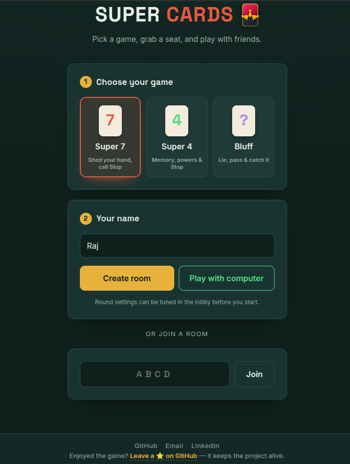
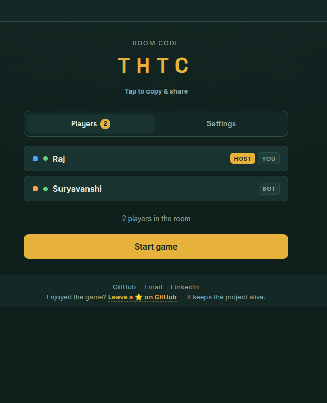
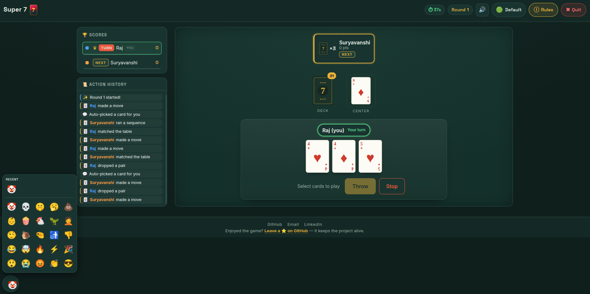
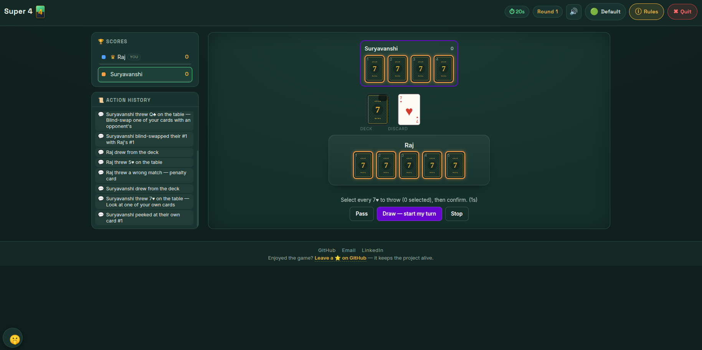
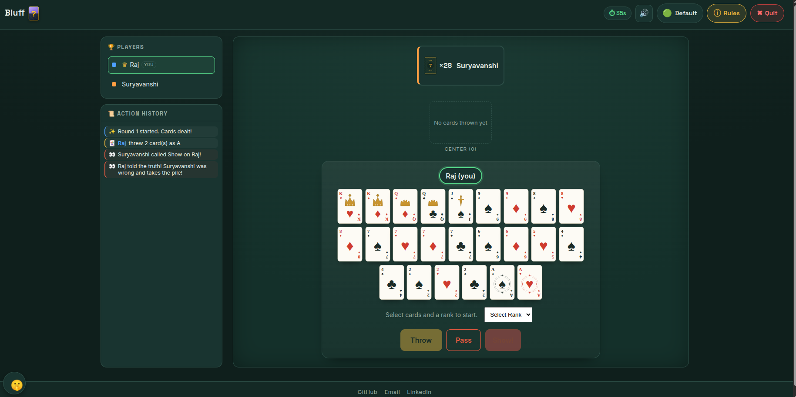

# 🃏 Super Cards

Card nights with friends, right in the browser. Start a table, share the code, and play
together in seconds — no download. Practise against the computer as a guest, or make a
free account to play with friends.

---

## 🚀 Play it now

Feedback, bug reports and ideas are always welcome.

---

## ✨ Why players like it

- Real-time tables: every move shows up for everyone instantly
- One code to invite friends — share it on WhatsApp and they're in
- Play on a phone, tablet or laptop, or install it as an app on your home screen
- Table chat, emoji reactions and a full action history
- Find other players, add friends and climb the leaderboard
- Computer players to fill out a short table, or to practise on your own
- A choice of table themes and card decks
- Fair play: nobody ever sees a card they shouldn't

---

## 📸 Gameplay preview

| Welcome screen | Live table |
| :---: | :---: |
|  |  |

---

## 🎮 Games

  

    
<strong>Super Seven</strong> — shed your hand and call Stop at the right moment

     
    
A fast round-based game: get rid of your cards and keep your total low enough to survive the table.

    <ul>
      <li><strong>Core loop:</strong> discard, pair, set, sequence, or match cards to reduce your hand.</li>
      <li><strong>Key twist:</strong> calling Stop can win the round — or backfire if you are not truly lowest.</li>
      <li><strong>Safe:</strong> reaching zero points takes you out of the Stop race for that round.</li>
    </ul>
  

  

  

    
<strong>Super Four</strong> — memory, deduction and hidden cards

     
    
Four face-down cards, a good memory, and card powers used at the right time.

    <ul>
      <li><strong>Setup:</strong> four hidden cards each, in fixed positions.</li>
      <li><strong>Turn:</strong> draw, keep or discard, and match cards on the table.</li>
      <li><strong>Highlights:</strong> table matches, card powers and risky Stop calls.</li>
    </ul>
  

  

  

    
<strong>Bluff</strong> — deception, challenges and reading the table

     
    
One rank is locked each round. Play it truthfully, bluff, or pass — and call Show when you smell a lie.

    <ul>
      <li><strong>Objective:</strong> be the first to get rid of all your cards.</li>
      <li><strong>Places:</strong> the game plays on for 2nd and 3rd place.</li>
      <li><strong>Drama:</strong> one Show can flip the whole round.</li>
    </ul>
  

  

  

    
<strong>Poker</strong> — No-Limit Texas Hold'em for play coins

     
    
Everyone starts with the same coins; bet, bluff and read the table to finish with the most.

    <ul>
      <li><strong>Setup:</strong> the host picks the starting coins and the number of rounds.</li>
      <li><strong>Every option:</strong> fold, check, call, bet, raise and all-in, with side pots and split pots.</li>
      <li><strong>Medals:</strong> the podium ranks players by the coins they finish with.</li>
    </ul>
    
Play money only — coins have no cash value.

  

---

## 📄 License

Copyright (c) 2024 PankajChauhanji. All Rights Reserved.

This repository is a public showcase of Super Cards. The game's source code is not
published here. Copying, modification, distribution, or use of any material in this
repository is prohibited without explicit written permission from the author.
